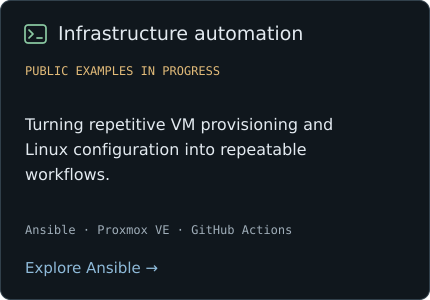
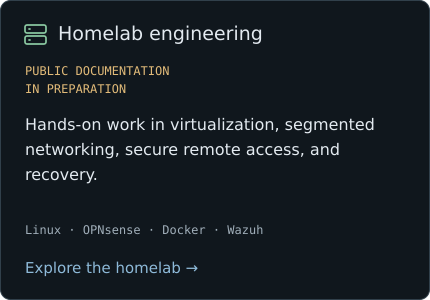
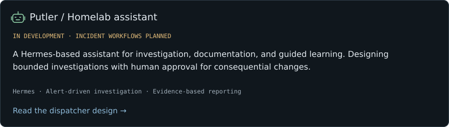

<picture>
  <source media="(prefers-color-scheme: dark)" srcset="assets/terminal-dark.svg">
  <source media="(prefers-color-scheme: light)" srcset="assets/terminal-light.svg">
  
</picture>

Activity refreshes every six hours. Streaks use the trailing year and UTC dates; contribution counts reflect GitHub's visibility rules. Latest push uses public events only.

# Ashton Ward

**Quality Assurance Engineer · Army National Guard Network Specialist · Homelab Builder**

I test distributed payment systems professionally and build infrastructure in my homelab. I enjoy tracing a problem across application, network, and operating system boundaries—and turning the fix into something repeatable.

My background combines software testing, Army National Guard network operations, and a **B.S. in Computer Science, Security & Privacy option**. I'm focused on growing toward infrastructure engineering and DevOps through hands-on work in networking, Linux, and automation.

[Explore my work](#selected-work) · [Current roadmap](https://github.com/AshtonWard/.github/issues) · [Ask a question](https://github.com/AshtonWard/.github/issues/new)

## Selected work

<a href="https://github.com/AshtonWard/Ansible"><picture>
  <source media="(prefers-color-scheme: dark)" srcset="assets/project-ansible-dark.svg">
  <source media="(prefers-color-scheme: light)" srcset="assets/project-ansible-light.svg">
  
</picture></a>
<a href="https://github.com/AshtonWard/Homelab"><picture>
  <source media="(prefers-color-scheme: dark)" srcset="assets/project-homelab-dark.svg">
  <source media="(prefers-color-scheme: light)" srcset="assets/project-homelab-light.svg">
  
</picture></a>

<a href="https://github.com/AshtonWard/.github/issues/94"><picture>
  <source media="(prefers-color-scheme: dark)" srcset="assets/project-putler-dark.svg">
  <source media="(prefers-color-scheme: light)" srcset="assets/project-putler-light.svg">
  
</picture></a>

## Tools I work with

   Linux &nbsp;&nbsp;
   Ansible &nbsp;&nbsp;
   Docker &nbsp;&nbsp;
   GitHub Actions &nbsp;&nbsp;
   PowerShell

| Area | Tools & practices |
| :--- | :--- |
| Infrastructure | Proxmox VE, Linux, Docker, Cloud-Init |
| Networking | OPNsense, Cisco IOS, VLANs, WireGuard, DNS |
| Automation | Ansible, GitHub Actions, PowerShell, shell scripting |
| Testing & security | REST APIs, Postman, JSON, Wireshark, Wazuh |

## Currently building toward

- More consistent provisioning, configuration, and service recovery through automation.
- Useful observability with Prometheus and Grafana; deployment is on the roadmap.
- Putler investigations grounded in evidence, with clear access and approval boundaries.

---

**How I work:** understand the system, test the assumptions, document what holds up.

Curious minds inspect the source. There may be something to capture.

<!-- ZmxhZ3t1bmRlcnN0YW5kX2F1dG9tYXRlX3ZlcmlmeX0= -->
