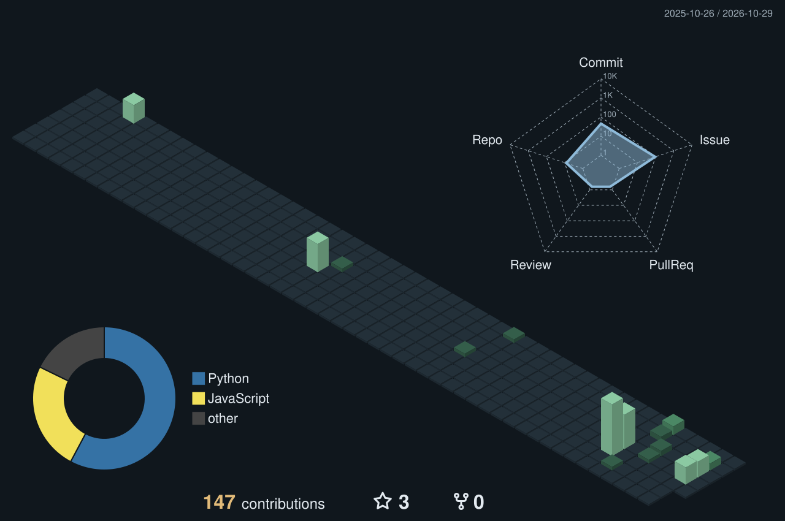

<picture>
  <source media="(prefers-color-scheme: dark)" srcset="assets/terminal-dark.svg">
  <source media="(prefers-color-scheme: light)" srcset="assets/terminal-light.svg">
  
</picture>

Activity refreshes every six hours. Streaks use the trailing year and UTC dates; contribution counts reflect GitHub's visibility rules. Latest push uses public events only.

# Ashton Ward

**Quality Assurance Engineer · Army National Guard Network Specialist · Homelab Builder**

I test distributed payment systems professionally and build infrastructure in my homelab. I enjoy tracing a problem across application, network, and operating system boundaries—and turning the fix into something repeatable.

My background combines software testing, Army National Guard network operations, and a **B.S. in Computer Science, Security & Privacy option**. I'm focused on growing toward infrastructure engineering and DevOps through hands-on work in networking, Linux, and automation.

[Explore my work](#selected-work) · [Current roadmap](https://github.com/AshtonWard/.github/issues) · [Ask a question](https://github.com/AshtonWard/.github/issues/new)

## Selected work

### 01 / Infrastructure automation

Replacing repetitive homelab administration with repeatable provisioning and configuration. My work connects **Ansible, Proxmox VE, Cloud-Init, and GitHub Actions** to create VMs, configure Linux hosts, and deploy services.

The public repository is where I'm building out generalized examples and documentation from that work.

**[Explore Ansible →](https://github.com/AshtonWard/Ansible)**

### 02 / Homelab engineering

A practical environment for learning how infrastructure behaves beyond installation day: **virtualization, network segmentation, secure remote access, container hosting, and security monitoring**. I use it to practice troubleshooting, recovery, and documenting decisions.

Public documentation is being prepared; the repository is currently a starting point.

**[Homelab documentation →](https://github.com/AshtonWard/Homelab)** · **[Follow the engineering roadmap →](https://github.com/AshtonWard/.github/issues)**

### 03 / Putler

An ongoing project to build a homelab assistant with **Hermes** for investigation, documentation, and guided learning. I'm designing an alert-driven model where monitoring detects incidents, bounded assistants investigate, and consequential changes require human approval.

The incident dispatcher and specialist workflows are planned work, tracked publicly.

**[Explore the incident dispatcher design →](https://github.com/AshtonWard/.github/issues/94)**

<!--SKYLINE:START-->

Contribution skyline — explore the 3D calendar

<picture>
  <source media="(prefers-color-scheme: dark)" srcset="profile-3d-contrib/night.svg">
  <source media="(prefers-color-scheme: light)" srcset="profile-3d-contrib/day.svg">
  
</picture>

Generated from GitHub activity; refreshes with the terminal stats every six hours. Built with <a href="https://github.com/yoshi389111/github-profile-3d-contrib">github-profile-3d-contrib</a>.

<!--SKYLINE:END-->

## Tools I work with

| Area | Tools & practices |
| :--- | :--- |
| Infrastructure | Proxmox VE, Linux, Docker, Cloud-Init |
| Networking | OPNsense, Cisco IOS, VLANs, WireGuard, DNS |
| Automation | Ansible, GitHub Actions, PowerShell, shell scripting |
| Testing & security | REST APIs, Postman, JSON, Wireshark, Wazuh |

## Currently building toward

- More consistent provisioning, configuration, and service recovery through automation.
- Useful observability with Prometheus and Grafana; deployment is on the roadmap.
- Putler investigations grounded in evidence, with clear access and approval boundaries.

---

**How I work:** understand the system, test the assumptions, document what holds up.

Curious minds inspect the source. There may be something to capture.

<!-- ZmxhZ3t1bmRlcnN0YW5kX2F1dG9tYXRlX3ZlcmlmeX0= -->
